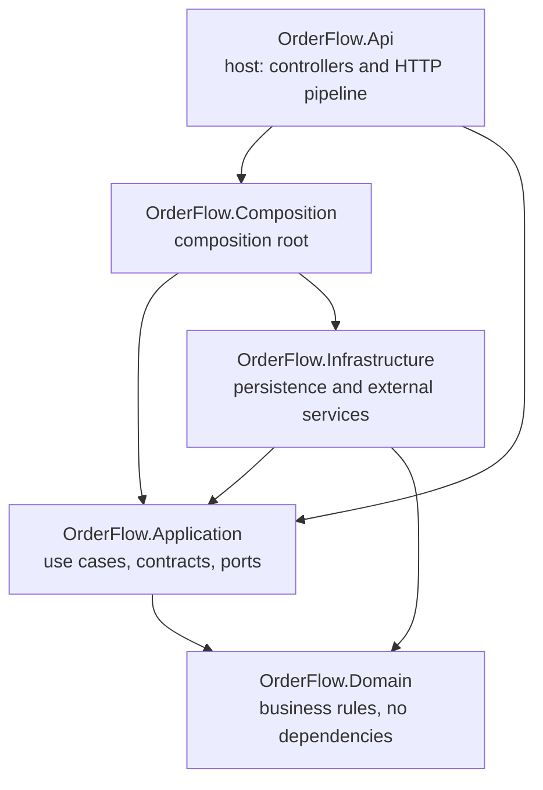

# OrderFlow

Multi-tenant order, inventory and customer API built with .NET 10, ASP.NET Core and SQL Server.
It is built phase by phase as an architecture project: every cross-cutting concern (errors, security,
rate limiting, observability, versioning) is in place before the first business endpoint.

## Architecture



Dependencies point inward. The API never references Infrastructure: it only calls `AddOrderFlow()` from
Composition, and `DisableTransitiveProjectReferences` keeps Infrastructure out of reach. The boundaries are
enforced by `tests/OrderFlow.ArchitectureTests`. Decisions and their reasons are recorded in
[`docs/decisiones.md`](docs/decisiones.md) and the full plan in [`docs/ARQUITECTURA.md`](docs/ARQUITECTURA.md)
(both in Spanish).

## Requirements

- [.NET SDK 10.0.4xx](https://dotnet.microsoft.com/download/dotnet/10.0) (pinned in `global.json`; check with `dotnet --version`)
- A trusted HTTPS development certificate: `dotnet dev-certs https --trust`
- Optional: Docker, to view telemetry locally (see below)

## Run the API

```powershell
git clone https://github.com/OscarAlejandrodelaCruzTorres/OrderFlow.git
cd OrderFlow
dotnet build OrderFlow.slnx
dotnet run --project src/OrderFlow.Api --launch-profile https
```

The API listens on `https://localhost:7007`. In Development:

| URL | What |
| --- | --- |
| `https://localhost:7007/swagger` | Swagger UI (use **Authorize** with a token) |
| `https://localhost:7007/openapi/v1.json` | OpenAPI document |
| `https://localhost:7007/health/live` | liveness probe, anonymous |

## Get a token

Every endpoint requires a JWT except the health probes. In Development the API trusts tokens from
`dotnet user-jwts`. From `src/OrderFlow.Api`:

```powershell
dotnet user-jwts create --role PlatformAdmin --output token
dotnet user-jwts create --role TenantUser --output token
```

The signing key is created in your user secrets on first use; it is valid only on your machine.

Call the API with the token:

```powershell
$token = "<paste the token>"
curl.exe -i -H "Authorization: Bearer $token" https://localhost:7007/api/v1/me
```

| Endpoint | No token | TenantUser | PlatformAdmin |
| --- | --- | --- | --- |
| `GET /api/v1/me` | 401 | 200 | 200 |
| `GET /api/admin/ping` | 401 | 403 | 204 |

### Using `OrderFlow.Api.http` in Visual Studio

`src/OrderFlow.Api/OrderFlow.Api.http` has happy-path and negative cases. Create
`src/OrderFlow.Api/http-client.env.json.user` (ignored by git) with your tokens:

```json
{
  "dev": {
    "tokenPlatformAdmin": "<token with PlatformAdmin>",
    "tokenTenantUser": "<token with TenantUser>"
  }
}
```

Reopen the `.http` file and select the **dev** environment.

## Run the tests

```powershell
dotnet test OrderFlow.slnx
```

| Project | What it checks |
| --- | --- |
| `OrderFlow.ArchitectureTests` | layer boundaries (ArchUnitNET) |
| `OrderFlow.IntegrationTests` | the real pipeline in memory: 401/403/200, error contract, health probes, invalid configuration stops the host. Tokens are signed with a test key; no user-jwts or user secrets needed. |
| `OrderFlow.UnitTests` | empty until the domain arrives |

## Configuration

| Section | Keys | Default |
| --- | --- | --- |
| `Cors` | `AllowedOrigins` (absolute origins, no trailing slash) | `[]` |
| `RateLimiting` | `PermitLimit`, `Window` | `60`, `00:01:00` |
| `RequestTimeout` | `Default` | `00:00:30` |

Settings are validated at startup: an invalid value or an unknown key stops the API instead of running
with a wrong limit. Errors are returned as ProblemDetails with a `type` from [`docs/errores.md`](docs/errores.md)
and a `traceId`.

## Local telemetry (optional)

```powershell
docker run --rm -d --name aspire-dashboard -p 18888:18888 -p 4317:18889 -e DASHBOARD__FRONTEND__AUTHMODE=Unsecured mcr.microsoft.com/dotnet/aspire-dashboard
dotnet run --project src/OrderFlow.Api --launch-profile https-telemetry
```

Open `http://localhost:18888`. Requests sent from the Visual Studio `.http` client arrive with a
non-sampled `traceparent` and are not recorded as traces; use the browser, Swagger or `curl.exe`.
